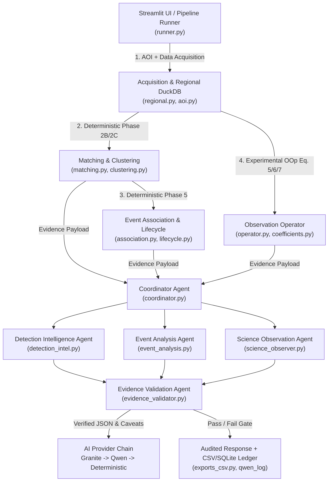
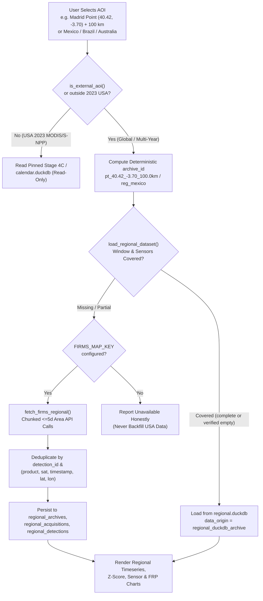

# FireAgent Calendar — Global Multi-Sensor Satellite Wildfire Analytics & Multi-Agent System

[](https://github.com/AxelNunezArzola11/Fire_Agent_Calendar)
[](requirements.txt)
[](src/calendar/processing/duckdb_layer.py)
[](src/calendar/agents/granite.py)
[](LICENSE)

> **Primary Application:** `calendar_app.py` (run locally with `.venv/bin/streamlit run calendar_app.py`).
> *Note:* The legacy `app.py` prototype remains preserved separately in the repository for reference; all active wildfire monitoring, analytics, regional archiving, and multi-agent capabilities live under `calendar_app.py` and `src/calendar/`.

---

## Table of Contents

1. [Project Title & Executive Overview](#1-project-title--executive-overview)
2. [Problem Statement & Scientific Motivation](#2-problem-statement--scientific-motivation)
3. [System Capabilities](#3-system-capabilities)
4. [Multi-Agent Architecture](#4-multi-agent-architecture)
5. [AI Provider Architecture](#5-ai-provider-architecture)
6. [End-to-End Functional Workflow](#6-end-to-end-functional-workflow)
7. [Data Processing Pipeline](#7-data-processing-pipeline)
8. [Historical Analytics Architecture](#8-historical-analytics-architecture)
9. [Geographic & Regional Analysis](#9-geographic--regional-analysis)
10. [Satellite Sources & Sensor Harmonization](#10-satellite-sources--sensor-harmonization)
11. [Sofiev & Kouznetsov (2026) Observation Operator](#11-sofiev--kouznetsov-2026-observation-operator)
12. [Statistical Baseline & Anomaly Methodology](#12-statistical-baseline--anomaly-methodology)
13. [Database & Storage Architecture](#13-database--storage-architecture)
14. [Repository Structure](#14-repository-structure)
15. [Local Installation & Execution](#15-local-installation--execution)
16. [Streamlit Community Cloud Deployment](#16-streamlit-community-cloud-deployment)
17. [Environment Variables & Secrets Reference](#17-environment-variables--secrets-reference)
18. [Super Intelligence Tech Stack](#18-super-intelligence-tech-stack)
19. [Scientific Integrity & Guardrails](#19-scientific-integrity--guardrails)
20. [Known Limitations](#20-known-limitations)
21. [Verification & Testing](#21-verification--testing)

Further reading: [User Guide](docs/USER_GUIDE.md) · [Scientific Methodology](docs/SCIENTIFIC_METHODOLOGY.md) · [Agent Architecture](docs/AGENT_ARCHITECTURE.md) · [Data Architecture](docs/DATA_ARCHITECTURE.md)

---

## 1. Project Title & Executive Overview

**FireAgent Calendar** is an auditable, deterministic Earth-observation analytics platform and bounded multi-agent system for satellite thermal fire monitoring across **MODIS (Terra, Aqua)** and **VIIRS (Suomi-NPP, NOAA-20, NOAA-21)**.

The system pairs:
- A pinned, reproducible **2023 Stage 4C USA baseline archive** (`482,672` normalized MODIS & VIIRS S-NPP detections in Hive-partitioned Parquet queried via `calendar.duckdb`),
- An **independent Regional DuckDB Archive layer** (`regional_archives/regional.duckdb`) that automatically resolves any global Area of Interest (preset regions such as **Madrid**, **Mexico**, **Brazil**, **Australia**, **Spain**, **Portugal**, **Canada**, **Chile**, point + radius queries such as `(40.42, -3.70) + 100 km`, map viewports, or custom EPSG:4326 bounding boxes), retrieves multi-year/live observations from NASA FIRMS on demand, deduplicates and persists them cleanly without ever contaminating the USA baseline, and
- A **6/7-stage orchestrated pipeline** (`src/calendar/pipeline/runner.py`) backed by five specialist/coordinating agents running **IBM Granite**, **Qwen**, or an offline **Deterministic Fallback** under fail-closed evidence verification.

---

## 2. Problem Statement & Scientific Motivation

Raw satellite active-fire products from NASA FIRMS report geolocated brightness temperatures and Fire Radiative Power ($\text{FRP}$ in MW) per overpass pixel. Without disciplined processing, operational and academic dashboards routinely suffer from four compounding errors:

1. **Cross-sensor conflation**: Summing 1 km MODIS pixels directly with 375 m VIIRS I-band detections treats physically incompatible footprints and confidence scales ($0\text{–}100$ vs `l`/`n`/`h`) as interchangeable.
2. **Repeated-pass inflation**: Counting every satellite overpass as a distinct wildfire conflates sensor revisit cadence with unique fire incidents.
3. **Regional archive conflation & empty-state hallucination**: Applying a single fixed regional archive globally either silently falls back to unrelated data or shows unrecoverable empty screens instead of isolating and automatically populating independent regional archives.
4. **Ungrounded LLM narratives**: Asking language models to summarize fire activity directly often hallucinates numbers, invents causal fire progression claims, or masks low-detectability physical limits.

FireAgent solves these problems by enforcing strict sensor separation, leakage-free statistical baselines, isolated regional DuckDB persistence, experimental pixel-level detectability diagnostics from **Sofiev & Kouznetsov (2026)**, and evidence-locked AI synthesis.

---

## 3. System Capabilities

- **Fire Calendar (`calendar_view.py`)**: Daily, weekly, and monthly summaries keyed strictly on **acquisition UTC timestamp** with dual raw vs. cross-sensor harmonized counts (`metrics_2d.json`, `index_2e.json`).
- **Interactive Activity Map (`map_view.py`)**: Folium/Leaflet geospatial explorer supporting **Detection Mode** (`cal_norm_v1` rows from DuckDB or live FIRMS) and **Cluster Mode** (`clusters.parquet`), dynamic FRP quartile / sensor coloring, density grids, AOI boundary overlays, and automatic persistence of fetched live FIRMS slices into `regional.duckdb`.
- **Historical Analytics (`analytics_view.py`)**:
  - **Pinned Stage 4C Baseline Mode**: Full 2023 USA multi-grain statistical baseline & anomaly series (`monthly_median`, `seasonal`, `sensor_aware` trailing windows).
  - **Dynamic Multi-Year & Global Regional Mode**: Automatically resolves the active AOI, queries `regional.duckdb`, auto-populates missing dates/sensors via NASA FIRMS Area API when `FIRMS_MAP_KEY` is configured, and plots time-series trends + baselines, Z-score anomalies, satellite/product distributions, and sensor-separated FRP intensity histograms.
- **Events & Alerts (`events_view.py`)**: Persistent Stage 5 SQLite event registry (`calendar_events.sqlite`), lifecycle tracking, alert subscriptions (optional SMTP notifications), and interactive multi-agent pipeline execution.
- **Data Export (`export_view.py`)**: Reproducible CSV downloads stamped with execution IDs, processing timestamps, SHA-256 provenance, and methodology notes.

---

## 4. Multi-Agent Architecture

FireAgent uses a bounded coordinator-and-specialist architecture (`src/calendar/agents/`). All physics, statistics, and event state transitions execute in deterministic Python **before** any agent synthesizes natural-language findings.



See [docs/AGENT_ARCHITECTURE.md](docs/AGENT_ARCHITECTURE.md) for complete contract schemas and validation checks.

---

## 5. AI Provider Architecture

Provider routing is managed cleanly in `src/calendar/agents/providers.py` and controlled by `CAL_AI_PROVIDER` (`auto`, `granite`, `qwen`, `deterministic`):

| Provider | Module | Transport / Endpoints | Behavior on Fault or Missing Key |
|---|---|---|---|
| **IBM Granite** | `src/calendar/agents/granite.py` (`GraniteProvider`, `GraniteConfig`) | 1. IBM **watsonx.ai REST** (`/ml/v1/text/generation`, IAM token exchange via `iam.cloud.ibm.com`)<br>2. **OpenAI-compatible** `/chat/completions` (e.g., Ollama, vLLM, hosted endpoints) | Transient HTTP `(429, 502, 503, 504)` retries up to `MAX_ATTEMPTS_CAP = 3`; auth/network/validation failure triggers immediate failover to deterministic rules without hiding the fault reason. |
| **Qwen** | `src/calendar/agents/providers.py` (`QwenChatProvider`) | OpenAI-compatible `/chat/completions` (`CAL_QWEN_ENABLED=true`, `CAL_QWEN_BASE_URL`, `CAL_QWEN_API_KEY` or `OPENROUTER_API_KEY`, `CAL_QWEN_MODEL`) | Fail-open to next configured provider or deterministic fallback with redacted latency and failure reason. |
| **Deterministic Fallback** | `src/calendar/agents/providers.py` (`DeterministicFallbackProvider`) & `src/calendar/events/qwen.py` | Pure offline Python rules (`findings_for`, rule templates) | **Always available.** Generates structured, evidence-grounded findings, citations, uncertainty bounds, and scientific caveats with zero network dependencies. |

Every secret is automatically scrubbed via `providers.redact()` before appearing in any UI warning, CSV log, or SQLite trace row.

---

## 6. End-to-End Functional Workflow

When a user selects an Area of Interest, date window, and AI provider in `calendar_app.py`:

1. **Centralized AOI Resolution (`src/calendar/ui/aoi.py`)**:
   - Priority: explicit `bbox` -> preset `region_id` -> `point_radius` (`radius_bbox`) -> viewport `map_geometry` -> `saved_aoi` -> session fallback (`cal_resolved_aoi`).
   - Never substitutes California or CONUS when no AOI is configured.
2. **Data Source Routing**:
   - **USA 2023 Baseline** (`full`, `california`, `conus` inside `2023-01-01..2023-12-31`, MODIS/S-NPP): reads pinned Stage 4C artifacts and `calendar.duckdb` in read-only mode.
   - **External Region / Multi-Year / NOAA-20 & NOAA-21**: routes through `regional.ensure_regional_archive_data(...)`, computing deterministic `archive_id`, checking `regional.duckdb` coverage, and automatically fetching missing days/sensors from NASA FIRMS Area API when `FIRMS_MAP_KEY` is configured.
3. **Deterministic Pipeline Execution (`src/calendar/pipeline/runner.py`)**:
   - Executes all 7 stages (`acquisition`, `detection`, `events`, `operator`, `validation`, `export`, `metrics`).
   - Stops and skips downstream stages cleanly (`skipped — ...`) if acquisition returns an invalid AOI, missing key, or 0 observations, preventing synthetic output generation.

---

## 7. Data Processing Pipeline

```mermaid
flowchart LR
    RAW["NASA FIRMS Area API /<br/>Local Raw CSVs"] -->|"SHA-256 + Schema Check"| NORM["Canonical Normalizer<br/>cal_norm_v1 (normalize.py)"]
    NORM -->|"USA 2023 Baseline"| PARQ["Hive Parquet Store<br/>normalized_parquet/cal_norm_v1/"]
    NORM -->|"External / Multi-Year AOIs"| REGDB["Regional DuckDB<br/>regional_archives/regional.duckdb"]
    PARQ --> USADB["calendar.duckdb<br/>(Read-Only View)"]
    USADB -->|"Phase 2B"| MATCH["Cross-Sensor Matcher<br/>matching.py (matcher_v1)"]
    MATCH -->|"Phase 2C"| CLU["Hotspot Clustering<br/>clustering.py (cluster_v1)"]
    CLU -->|"Phase 2D/2E"| MET["Metrics & Dual Index<br/>metrics_2d.json, index_2e.json"]
    MET -->|"Phase 4B/4C"| ANOM["Baselines & Anomalies<br/>baselines_4b.json, anomalies_4c.json"]
    CLU -->|"Phase 5A-5C"| EVSQL["SQLite Event Store<br/>calendar_events.sqlite"]
    REGDB -->|"Dynamic Series"| REGT["Regional Timeseries &<br/>Distributions (regional.py)"]
```



---

## 8. Historical Analytics Architecture

`src/calendar/ui/analytics_view.py` distinguishes two analytics modes cleanly so users always know the origin and statistical meaning of every plotted point:

1. **Pinned Stage 4C Baseline Archive (2023 USA · MODIS + VIIRS S-NPP)**:
   - Reads verified `anomalies_4c.json` (`CAL_EXEC_4C`), checked against `analytics_runs.jsonl` (`query.artifact_status`). Incomplete or missing execution artifacts fail loudly rather than displaying stale or synthetic values.
2. **Dynamic Multi-Year / Regional (DuckDB + NASA FIRMS)**:
   - Resolves `archive_id`, loads or populates `regional.duckdb`, and displays:
     - **Provenance Status Banner** (`Pinned Stage 4C Baseline Archive`, `Independent Regional DuckDB Archive (Previously Archived)`, `Newly retrieved NASA FIRMS API -> Stored in Regional DuckDB`, `Verified Empty Window`, or `Unavailable`),
     - **Observed Activity & Trailing Historical Baseline** line/bar charts (`float64`-safe NaN gaps for `insufficient-history`),
     - **Statistical Deviation ($Z$-Score)** bar chart and inspectable notable anomaly periods,
     - **Satellite & Sensor Distribution** (`by_satellite`, `by_product` counts and MW breakdown),
     - **FRP Intensity Distribution** (`0–5`, `5–20`, `20–50`, `50–100`, `100–500`, `500+` MW separated between MODIS and VIIRS) plus day/night split and stored regional archive catalog.

---

## 9. Geographic & Regional Analysis



- **Preset regions (`src/calendar/processing/regions.py`)**: `california`, `madrid`, `mexico`, `brazil`, `spain`, `australia`, `conus`, `portugal`, `canada`, `chile`.
- **Border-region isolation (`aoi.is_external_aoi`)**: Named non-USA presets (including `mexico` and `canada`, whose rectangular envelopes adjoin US border latitudes) and non-USA point+radius centers are explicitly isolated so `calendar.duckdb` rows from Texas/California/Alaska are never mixed into neighboring country analytics.

---

## 10. Satellite Sources & Sensor Harmonization

Configured centrally in `src/calendar/acquisition/sensors.py` (`ALL_PRODUCTS`, `SENSOR_AVAILABILITY`):

| Product ID | Satellite | Instrument | Nominal Resolution | Confidence Scale | FIRMS Archive Coverage | Local 2023 Archive |
|---|---|---|---|---|---|---|
| `modis` | Terra, Aqua | MODIS | ~1.0 km nadir | Numeric `0–100` | Terra `2000-11-01+`, Aqua `2002-07-04+` | Yes (USA 2023) |
| `viirs-snpp` | `N` (Suomi-NPP) | VIIRS I-band | ~375 m nadir | Categorical `l` / `n` / `h` | `2012-01-20+` | Yes (USA 2023) |
| `viirs-noaa20` | `NOAA-20` (JPSS-1) | VIIRS I-band | ~375 m nadir | Categorical `l` / `n` / `h` | `2018-04-01+` | Regional / Live FIRMS |
| `viirs-noaa21` | `NOAA-21` (JPSS-2) | VIIRS I-band | ~375 m nadir | Categorical `l` / `n` / `h` | `2023-03-01+` | Regional / Live FIRMS |

- **SP vs. NRT routing**: `sensors.select_firms_sources_for_range` prioritizes Standard (`_SP`) science-quality feeds when available and falls back to Near Real-Time (`_NRT`) only within the active NRT trailing horizon (~60 days) or when SP availability lags, recording explicit `sensor_notes` in every UI card and dataset summary.

---

## 11. Sofiev & Kouznetsov (2026) Observation Operator

FireAgent includes a standalone, strictly labeled experimental implementation of the fire radiative power observation operator published in **Sofiev & Kouznetsov (2026)**, *Geoscientific Model Development* **19**, 10123–10142 ([DOI: 10.5194/gmd-19-10123-2026](https://doi.org/10.5194/gmd-19-10123-2026)), located under `src/calendar/experimental/frp_operator_pilot/`.

### 11.1 Mathematical Formulation

Given pixel area $A_p$ ($\text{km}^2$), fire radiative power $P$ ($\text{MW}$), sensor product $s \in \{\text{modis}, \text{viirs-snpp}\}$, and overpass illumination flag $d \in \{\text{D}, \text{N}\}$:

1. **Pixel Area Proxy (`operator.py:pixel_area_km2`):**
   $$A_p \approx \text{scan} \times \text{track} \quad [\text{km}^2]$$
   *(Uses FIRMS `scan` and `track` dimensions when viewing zenith angle is absent from FIRMS Area CSVs.)*

2. **Pixel Detection Limit $D_p$ — Eq. (5) (`operator.py:detection_limit`):**
   $$D_p(A_p; s, d) = \lambda_{s,d}\, A_p + \mu_{s,d} \quad [\text{MW}]$$

3. **Sigmoid Transition Rate $r$ — Eq. (6) (`operator.py:transition_rate`):**
   $$r(A_p; s, d) = r_{0, s, d} + \frac{r_{1, s, d}}{A_p - A_0}, \qquad A_0 = 0 \quad [\text{MW}^{-1}]$$

4. **Pixel Detection Probability $p(P)$ — Eq. (7) (`operator.py:detection_probability`):**
   $$p(P; A_p, s, d) = \operatorname{clip}_{[0, 1]}\!\left( \frac{\sigma\!\big((P - D_p)\, r\big) - c_{o, s, d}}{1 - c_{o, s, d}} \right), \qquad \sigma(z) = \frac{1}{1 + e^{-z}}$$
   with $p(0) = 0$ explicitly enforced and sigmoid exponent $z$ bounded to $[-60, 60]$.

5. **Expected Retrieved FRP Diagnostic (`operator.py:expected_frp`):**
   $$E_{\text{ret}}(P) = p(P; A_p, s, d) \cdot P \quad [\text{MW}]$$

6. **Diagnostic Regime Convention (`operator.py:detection_regime`):**
   Defining margin $M = P - D_p$ and convention half-width $\Delta = 2 / r$:
   - `no-fire` ($P = 0$), `below-limit` ($M < -\Delta$), `transition` ($|M| \le \Delta$), `above-limit` ($M > \Delta$).

7. **Exploratory & Indicative Extensions (`operator.py`):**
   - **Cross-Sensor Exploratory Form (Eq. 13, `cross_map_expected`)**: evaluates the target sensor operator at the source detection's $P$ and $A_p$ (`validation_status = "exploratory-unvalidated"`).
   - **Smoke / AOD Attenuation (Eq. 12, `aod_attenuation`)**: $P_{\text{att}} = P \exp(-\tau_{4\,\mu\text{m}})$ (`validation_status = "indicative-unvalidated"`, no production AOD source wired).

### 11.2 Published Coefficients (`coefficients.py`, Tables 1–2)

| Product (`s`) | Day/Night (`d`) | $\lambda$ ($\text{MW}/\text{km}^2$) | $\mu$ ($\text{MW}$) | $r_0$ ($\text{MW}^{-1}$) | $r_1$ ($\text{km}^2/\text{MW}$) | $c_o$ |
|---|---|---:|---:|---:|---:|---:|
| `modis` | `D` | `4.44` | `0.52` | `0.07` | `1.26` | `0.045` |
| `modis` | `N` | `4.43` | `1.01` | `0.11` | `1.06` | `0.045` |
| `viirs-snpp` | `D` | `6.17` | `1.44` | `0.61` | `0.21` | `0.050` |
| `viirs-snpp` | `N` | `1.38` | `0.35` | `2.12` | `1.02` | `0.050` |

### 11.3 Implementation Status Matrix

| Component | Code Location | Status | Notes |
|---|---|---|---|
| **Eq. (5)–(7) Pixel Operator & Expected FRP** | `src/calendar/experimental/frp_operator_pilot/operator.py` | **Implemented (Experimental)** | Runs conditionally on detected MODIS (`D`/`N`) and VIIRS S-NPP (`D`/`N`) rows; NOT an atmospheric/extinction inversion. |
| **Pixel Eligibility & Guardrails** | `src/calendar/experimental/frp_operator_pilot/validation.py`, `results.py` | **Implemented** | Excludes `viirs-noaa20`, `viirs-noaa21` (no published coefficients), missing FRP, or non-positive area cleanly. |
| **Eq. (12) AOD Attenuation** | `operator.py:aod_attenuation` | **Indicative Only** | Implemented helper; marked `indicative-unvalidated`; no production AOD feed connected. |
| **Eq. (13) Cross-Sensor Mapping** | `operator.py:cross_map_expected` | **Exploratory Only** | Marked `exploratory-unvalidated`; lacks overpass coincidence & diurnal refit. |
| **Eq. (8)–(11) Gridded Operator** | — | **Not Implemented** | Grid-cell forward integration is outside the scope of this pixel-level pilot. |

---

## 12. Statistical Baseline & Anomaly Methodology

Deterministic baselines (`src/calendar/analytics/baselines.py`) and anomalies (`src/calendar/analytics/anomalies.py`) guarantee **zero future leakage**:

- **Trailing baseline (`sensor_aware` / `trailing`)**:
  $$\mathcal{R}_t = \{Y_s : t - K \le s \le t - 1\}, \qquad K \in \{30\text{ daily},\; 12\text{ weekly},\; 6\text{ monthly}\}$$
- **Median Baseline & Parametric Moments**:
  $$\text{Baseline}_t = \operatorname{median}(\mathcal{R}_t), \qquad Z_t = \frac{Y_t - \bar{Y}_{\mathcal{R}_t}}{s_{\mathcal{R}_t}}, \qquad \text{PctDev}_t = \frac{Y_t - \text{Baseline}_t}{\text{Baseline}_t} \times 100\%$$
- **Honest Eligibility Floors**:
  - Median requires $|\mathcal{R}_t| \ge \text{MEDIAN\_MIN\_N} = 3$ (else `insufficient-history`, rendered as a chart gap — never zero-filled).
  - $Z$-score requires $|\mathcal{R}_t| \ge \text{ZSCORE\_MIN\_N} = 7$ and reference variance above `VARIANCE_RTOL = 1e-9` (else `unstable` / `unavailable`).
  - Dual notable gate (`classify_v1`): $|Z_t| \ge 2.0$ **and** $|\text{PctDev}_t| \ge 25\%$.

---

## 13. Database & Storage Architecture

- **Pinned Stage 4C USA Baseline (`calendar.duckdb`)**: Read-only DuckDB view over Hive-partitioned Parquet (`normalized_parquet/cal_norm_v1/product=*/sensor=*/year=*/month=*/*.parquet`). Completely protected from regional writes (`regional.resolve_regional_db_path` raises `ValueError` if pointed at `calendar.duckdb`).
- **Independent Regional Historical Archives (`regional_archives/regional.duckdb`)**: Auto-initialized DuckDB database containing `regional_archives` (AOI bbox, center lat/lon, radius km), `regional_acquisitions` (execution ledger, FIRMS sources, `exec_id`, status), and `regional_detections` (deduplicated `cal_norm_v1` rows partitioned logically by `archive_id`). Falls back transparently to temp storage if deployed on a read-only workspace mount.
- **SQLite Operational Store (`calendar_events.sqlite`)**: Stores Stage 5 events, lifecycle transitions, alert records, notification logs, and agent/LLM audit trails (`qwen_log`). Automatically decompressed from `calendar_events.sqlite.gz` on cloud environments where `.sqlite` is gitignored.

See [docs/DATA_ARCHITECTURE.md](docs/DATA_ARCHITECTURE.md) for full table definitions.

---

## 14. Repository Structure

```text
fireagent/
├── calendar_app.py                     # Primary Streamlit entrypoint (FireAgent Calendar)
├── app.py                              # Legacy wildfire risk prototype (preserved separately)
├── requirements.txt                    # Streamlit Cloud runtime pins (Python 3.11)
├── calendar.duckdb                     # Read-only DuckDB view over Stage 4C USA Parquet
├── calendar_events.sqlite.gz           # Compressed Stage 5 event store (cloud-compatible)
├── normalized_parquet/                 # Hive-partitioned 2023 USA baseline Parquet dataset
├── analytics_output/                   # Pinned Stage 2A-4C analytical JSON & Parquet runs
├── analytics_runs.jsonl                # Execution ledger verifying Stage 2A-4C completion
├── docs/
│   ├── USER_GUIDE.md                   # End-user guide & AOI/FIRMS instructions
│   ├── SCIENTIFIC_METHODOLOGY.md       # Mathematical equations & OOp reference
│   ├── AGENT_ARCHITECTURE.md           # 7-stage pipeline, 5 agents & validation gates
│   └── DATA_ARCHITECTURE.md            # Dual DuckDB + Parquet + SQLite schema docs
├── src/calendar/
│   ├── settings.py                     # Centralized env / st.secrets configuration
│   ├── acquisition/                    # NASA FIRMS Area API, sensor availability & transport
│   ├── processing/                     # Canonical normalizer, regions registry, DuckDB layer
│   ├── analytics/                      # Phase 2B matching, 2C clustering, 4B/4C baselines/anomalies
│   ├── events/                         # Stage 5 event association, lifecycle, alerts, SQLite store
│   ├── pipeline/
│   │   ├── regional.py                 # Regional DuckDB archive engine, auto-populator & timeseries
│   │   └── runner.py                   # 7-stage deterministic + multi-agent orchestrator
│   ├── agents/                         # Coordinator, 3 specialist workers, Validator, Granite & Qwen
│   ├── experimental/frp_operator_pilot/# Sofiev & Kouznetsov (2026) Eq. 5/6/7/12/13 pilot
│   ├── l2/                             # Optional NASA CMR VNP14IMG Level-2 colocation
│   ├── storage/                        # Disk budget, manifest & integrity checks
│   └── ui/                             # Streamlit tab views (calendar, map, analytics, events, export, aoi, query)
├── scripts/                            # Reproducible Phase 1-5 CLI rebuild scripts
└── tests/                              # Targeted & end-to-end automated test suite
```

---

## 15. Local Installation & Execution

```bash
# 1. Clone and enter repository
git clone https://github.com/AxelNunezArzola11/Fire_Agent_Calendar.git
cd Fire_Agent_Calendar

# 2. Create Python 3.11 environment and install runtime dependencies
python3.11 -m venv .venv
.venv/bin/pip install --upgrade pip
.venv/bin/pip install -r requirements.txt

# 3. Configure local secrets (never commit .env)
cp .env.example .env
# Edit .env and add FIRMS_MAP_KEY (required for live / regional FIRMS fetches)
# Optionally add WATSONX_API_KEY, WATSONX_PROJECT_ID, WATSONX_URL (for IBM Granite)

# 4. Run FireAgent Calendar locally
.venv/bin/streamlit run calendar_app.py
```

---

## 16. Streamlit Community Cloud Deployment

1. Connect the GitHub repository (`main` branch) to Streamlit Community Cloud with main file path **`calendar_app.py`** and Python **`3.11`**.
2. Add your secrets under **App settings -> Secrets** (TOML format):
   ```toml
   FIRMS_MAP_KEY = "your_nasa_firms_map_key"
   CAL_AI_PROVIDER = "auto" # "granite" | "qwen" | "deterministic" | "auto"
   WATSONX_API_KEY = "your_watsonx_api_key"
   WATSONX_PROJECT_ID = "your_project_id"
   WATSONX_URL = "https://us-south.ml.cloud.ibm.com"
   ```
3. On cold start, `calendar_app.py` / `query.py` automatically unpacks `calendar_events.sqlite.gz`, mounts `calendar.duckdb` in read-only mode against `normalized_parquet/`, verifies `CAL_EXEC_*` artifacts via `analytics_runs.jsonl`, and initializes `regional.duckdb` cleanly in writable storage when external regions are queried.

---

## 17. Environment Variables & Secrets Reference

| Variable | Default | Description |
|---|---|---|
| `FIRMS_MAP_KEY` | `""` | NASA FIRMS API key required for live & regional NASA FIRMS retrieval. |
| `CAL_DUCKDB_PATH` | `calendar.duckdb` | Read-only Stage 4C USA DuckDB path. |
| `CAL_REGIONAL_DUCKDB_PATH` | `regional_archives/regional.duckdb` | Writable independent regional historical archive DuckDB path. |
| `CAL_REGIONAL_ROOT` | `regional_archives` | Root directory for regional archive storage. |
| `CAL_PARQUET_ROOT` | `normalized_parquet` | Root directory for Stage 1D Hive-partitioned Parquet. |
| `CAL_ANALYTICS_ROOT` | `analytics_output` | Root directory for execution-ID-keyed Stage 2–4 artifacts. |
| `CAL_RUNS_PATH` | `analytics_runs.jsonl` | Execution status verification ledger. |
| `CAL_EVENTS_DB_PATH` | `calendar_events.sqlite` | Stage 5 SQLite database path. |
| `CAL_EXEC_2A` .. `CAL_EXEC_4C` | Verified IDs in `settings.py` | Pinned execution IDs for Stage 2A through 4C outputs. |
| `CAL_AI_PROVIDER` | `auto` | AI synthesis chain selector (`auto`, `granite`, `qwen`, `deterministic`). |
| `WATSONX_API_KEY` / `CAL_GRANITE_API_KEY` | `""` | IBM Cloud IAM / OpenAI-compatible API key for IBM Granite. |
| `WATSONX_PROJECT_ID` / `CAL_GRANITE_PROJECT_ID` | `""` | IBM watsonx.ai project UUID (omit when using `/v1` OpenAI-compatible endpoints). |
| `WATSONX_URL` / `CAL_GRANITE_BASE_URL` | `""` | Base endpoint URL (`https://us-south.ml.cloud.ibm.com` or `https://.../v1`). |
| `WATSONX_MODEL_ID` / `CAL_GRANITE_MODEL` | `ibm/granite-4-h-small` | Granite model identifier. |
| `CAL_QWEN_ENABLED` | `false` | Enables `QwenChatProvider` when base URL, API key, and model are configured. |
| `CAL_FIRMS_MAX_DAYS` | `366` | Maximum day span per chunked live FIRMS request loop. |
| `CAL_SMTP_ENABLED`, `CAL_SMTP_*` | `false` | Optional STARTTLS email digest delivery settings. |

---

## 18. Super Intelligence Tech Stack

To maintain clear technical and provenance transparency, the project's toolchain is categorized by functional role:

### A. Runtime Application Stack (Deployed Software Dependencies)
- **Language & Core Compute**: Python 3.11, NumPy `2.4.6`, Pandas `3.1.1`, PyArrow `26.0.1`.
- **Database & Analytical Engines**: DuckDB `2.0.0` (Dual-tier USA Baseline + Independent Regional Archives), SQLite3 (Stage 5 transactional event store), Hive-partitioned Parquet.
- **Web Interface & Geospatial Rendering**: Streamlit `1.67.0`, Folium `0.20.0`, `streamlit-folium 0.27.4`, `rasterio 1.4.4`.
- **Remote Sensing & Cloud Inference**: NASA FIRMS Area API (MODIS, VIIRS S-NPP/NOAA-20/NOAA-21), NASA CMR STAC/Search (`VNP14IMG`), OpenStreetMap Nominatim Geocoding, IBM watsonx.ai REST (`ibm/granite-4-h-small`), OpenAI-compatible chat endpoints (Qwen / Granite), `requests 2.34.2`, `python-dotenv 1.2.4`.

### B. AI & Development Assistance Tools (Engineering & Coding Workflow)
- **Antigravity IDE (Gemini 3.1 Pro, Claude Opus 4.6, Claude Sonnet 4.6)** and **Claude Code**: Used during engineering, debugging, code auditing, scientific equation verification, test authoring, and documentation generation. *(Zero runtime IDE dependencies.)*

### C. Presentation, Documentation & Media Tools (Non-Runtime Communication Assets)
- **Gamma / Canva / CapCut / NotebookLM / Veo 3.1 / Nano Banana / Google Slides**: Used externally to prepare presentation decks, architecture visuals, video walkthroughs, and outreach documentation. *(Not executed inside the Python/Streamlit runtime.)*

---

## 19. Scientific Integrity & Guardrails

1. **No Synthetic Observations**: If `calendar.duckdb`, `regional.duckdb`, or `FIRMS_MAP_KEY` lacks coverage for a selected window, FireAgent displays explicit unavailable or zero-observation states — never synthetic rows, noise, or smoothed fake baselines.
2. **Strict USA vs. External Region Isolation**: External regional requests (e.g., Madrid, Mexico, Brazil, Australia) are strictly forbidden from reading or backfilling `calendar.duckdb` (`482,672` USA detections), and external writes are strictly blocked from touching `calendar.duckdb`.
3. **Sensor Separation**: MODIS ($\approx 1\text{ km}$, continuous $0\text{–}100$) and VIIRS ($\approx 375\text{ m}$, categorical `l`/`n`/`h`) FRP totals are always stratified per product/sensor.
4. **Evidence-Gated LLMs**: Both IBM Granite and Qwen must emit structured JSON whose cited IDs and numerical quantities pass `evidence_validator.check_llm_json(...)`; invalid outputs fall back immediately to `DeterministicFallbackProvider`.

---

## 20. Known Limitations

- **Satellite Detections $\neq$ Confirmed Wildfires**: Thermal anomalies include agricultural burns, industrial heat sources, gas flares, and false positives; persistence clusters are spatial-temporal groupings rather than surveyed fire perimeters.
- **Overpass-Dependent Detection Sensitivity**: Pixel detection probability varies strongly with off-nadir pixel growth (`scan × track`), cloud/smoke obscuration, vegetation canopy, and diurnal overpass timing (`10:30` / `13:30` LST).
- **Observation Operator Scope**: Sofiev & Kouznetsov (2026) Tables 1–2 cover only `modis` and `viirs-snpp`; `viirs-noaa20` and `viirs-noaa21` are excluded from expected-FRP calculations (`operator.py` / `validation.py`), and gridded Eqs. (8)–(11) are not implemented.
- **NASA FIRMS API Keys & Quotas**: Dynamic population of unarchived external regions requires a valid NASA FIRMS `FIRMS_MAP_KEY` and obeys NASA EOSDIS Area API rate limits.

---

## 21. Verification & Testing

Run fast targeted verification tests locally without triggering slow live external LLM/Streamlit suites:

```bash
# Regional DuckDB archive isolation, auto-population, Historical Analytics & IBM Granite tests
.venv/bin/python -m pytest tests/test_regional_analytics_granite.py -q

# Streamlit Cloud storage diagnostics & fail-closed behavior checks
.venv/bin/python -m pytest tests/test_calendar_cloud_repair.py -k "not test_8" -q
```
